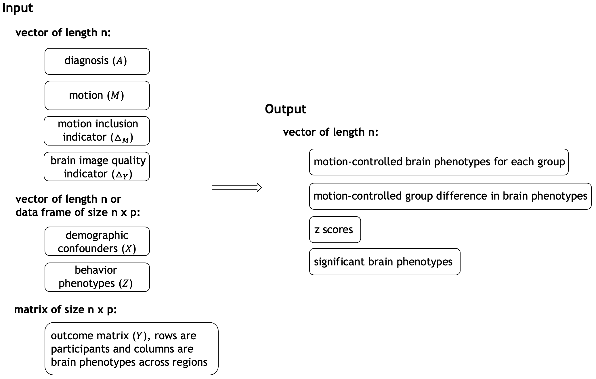

# MoCo: **Mo**tion-**Co**ntrolled Brain-Phenotype Differences Between Groups


> Nonparametric estimation of group-specific brain-phenotype means and group
> differences while accounting for motion-related selection.

MoCo is an R package for brain-imaging analyses in which motion affects both
data quality and inclusion in the analyzed sample. The package combines
one-step estimation, flexible nuisance-function learning, optional
cross-fitting, and efficient-influence-function (EIF) inference. Outcomes may
be functional-connectivity edges, regional imaging measures, or other
continuous brain phenotypes.

## Highlights

- A single high-level function, `moco()`, supports HAL, log-normal GLM, and
  GAMLSS (generalized gamma) models for conditional motion densities.
- Nuisance regressions can be estimated with Super Learner or user-specified
  GLMs.
- Cross-fitting and repeated cross-fitting are supported; repeated seeds are
  combined by averaging the estimates and the participant-level EIFs, followed
  by one simultaneous test.
- If motion `M = NULL`, a missing data method is implemented using the data availability `Delta_Y = 1`, similar to Nebel et al. (2022).
- EIF-based simultaneous confidence bands control the family-wise error rate
  (FWER) across multiple outcomes.

## Installation

Install the development version from GitHub:

```r
# install.packages("remotes")
remotes::install_github("thebrisklab/MoCo")
```

Then load the package:

```r
library(MoCo)
```

Core dependencies, including `SuperLearner`, `haldensify`, `gamlss`,
`gamlss.dist`, and `mgcv`, are installed with MoCo. The default Super Learner
library (`SL_library`) includes `SL.mgcv_gam`, a generalized additive model
learner provided by MoCo that uses `mgcv::gam()`. It also uses `SL.earth`,
`SL.glmnet`, `SL.ranger`, and `SL.xgboost`, whose packages are suggested
rather than required. Install them before running `moco()` with the default
library:

```r
install.packages(c("earth", "glmnet", "ranger", "xgboost"))
```

They are not needed when `SL_library` contains only other learners, for
example `c("SL.mean", "SL.glm")`. The `SuperLearner` learner `SL.gam`, which
uses the `gam` package, can still be added to `SL_library` after
`install.packages("gam")`. Surface plotting additionally requires
`ciftiTools` and Connectome Workbench.

## Description of the main function

`moco()` is the main function of MoCo. Its inputs and outputs are illustrated
below.



The full call, with the default value of every argument, is shown below.
`gamlss_options` defaults to `NULL`, which uses the basic GAMLSS settings
shown; its other entries are described under GAMLSS options.

```r
moco(
  X, Z, A, M, Y,
  Delta_M = NULL,
  Delta_Y,
  thresh = NULL,
  SL_library = c(
    "SL.earth", "SL.glmnet", "SL.mgcv_gam", "SL.glm",
    "SL.glm.interaction", "SL.step", "SL.step.interaction",
    "SL.xgboost", "SL.ranger", "SL.mean"
  ),
  SL_library_customize = list(
    gA = NULL, gDM = NULL, gDY_AX = NULL, gDY_AXZ = NULL,
    mu_AMXZ = NULL, eta_AXZ = NULL, eta_AXM = NULL, xi_AX = NULL
  ),
  glm_formula = list(
    gA = NULL, gDM = NULL, gDY_AX = NULL, gDY_AXZ = NULL,
    mu_AMXZ = NULL, eta_AXZ = NULL, eta_AXM = NULL, xi_AX = NULL
  ),
  density_method = "hal",
  HAL_options = list(
    max_degree = 3,
    lambda_seq = exp(seq(-1, -10, length = 100)),
    num_knots = c(1000, 500, 250)
  ),
  glm_options = list(pMX = ".", pMXZ = "."),
  gamlss_options = list(
    mu = "smooth",
    sigma = "linear",
    nu = "1",
    smooth = NULL,
    trace = TRUE
  ),
  cross_fit = TRUE,
  cv_folds = 5,
  seed_rng = 1,
  test = TRUE,
  fwer = 0.05,
  hypo_method = "multiplier",
  hypo_n_sim = 10000L,
  hypo_seed = 1
)
```

The arguments are introduced below in the order of a typical analysis: the
input data, the nuisance regressions, the outputs, the motion-density model,
the simultaneous test (`test = TRUE`), and cross-fitting with multiple outcomes
and repeated seeds. In the code below, `X`, `Z`, `A`, `M`, `Y`, `Delta_M`, and
`Delta_Y` stand for the user's own data; the tutorial further below runs MoCo
on the bundled example data.

### Input data

`moco()` uses the following data objects:

| Object | Role |
|---|---|
| `A` | Binary exposure or group indicator |
| `X` | Baseline covariates |
| `Z` | Post-exposure covariates used in the selection-bias adjustment |
| `M` | Continuous motion measure |
| `Y` | Continuous outcome vector or an `n` by `p` outcome matrix |
| `Delta_M` | Indicator that motion satisfies the analysis inclusion rule |
| `Delta_Y` | Indicator that the imaging outcome is observed and usable |
| `thresh` | Optional motion threshold c; defines `Delta_M = 1(M <= c)` when `Delta_M` is not given, and truncates the GAMLSS and GLM densities `pMXD`/`pMXZD` at c |

`A`, `X`, and `Z` must be complete. `Y` may contain missing values in rows for
which `Delta_Y = 0`. For a seed-based analysis, a seed-to-self outcome column
may be entirely missing; MoCo restores that position as `NA` in its outputs.

`Delta_M` is required unless `thresh` is given. Participants with missing `M`
must have `Delta_M = 0` and `Delta_Y = 0`. For a motion threshold, give
`thresh = c` (for example `thresh = 0.2`) instead of `Delta_M`: `moco()` then
sets `Delta_M = as.numeric(!is.na(M) & M <= c)`. If both are given, `Delta_M`
must equal that rule. The definitions of `Delta_M` and `Delta_Y` should be
prespecified and reported with the analysis.

The motion densities conditional on `Delta_M = 1` are fitted on the
participants with `Delta_M = 1` and evaluated at every observed `M`, including
participants with `Delta_M = 0`. Outside the range of `M` among the
`Delta_M = 1` training participants the density is set to zero (GLM, HAL, and
GAMLSS). `Delta_M` need not be determined by `M` alone (for example, a
minimum number of frames after censoring).

With `thresh = c` and `density_method = "gamlss"` or `"glm"`, `pMXD` and
`pMXZD` are truncated generalized gamma or log-normal densities. An
untruncated GG or log-normal GLM is fitted on all participants with observed
`M` (within each training fold) and truncated analytically at `c`:
`p(m | Delta_M = 1, a, x) = f(m | a, x) / F(c | a, x)` for `m <= c` and 0
above `c`, where `f` and `F` are the fitted density and CDF (and the same with
`z` added for `pMXZD`; `F(c | a, x)` is floored at 0.001). `pMX` and `pMXZ`
are fitted on `Delta_Y = 1` as described above. With HAL, `thresh` only
defines `Delta_M`. If `Delta_M` is supplied without `thresh` and every `M`
with `Delta_M = 1` is below every `M` with `Delta_M = 0`, a GAMLSS or GLM run
gives a message suggesting `thresh`.

When motion is unavailable, set `M = NULL` (and optionally `X = NULL`) and
supply `Delta_M`; participants with `Delta_M = 0` are then treated as missing,
as in Nebel et al. (2022).

### Nuisance regressions

MoCo estimates its nuisance regressions with Super Learner or with
user-specified GLMs:

| Argument | Description |
|---|---|
| `SL_library` | Common Super Learner library for all nuisance regressions (default shown in the call above); if `NULL`, the libraries in `SL_library_customize` are used |
| `SL_library_customize` | Separate Super Learner libraries for `gA`, `gDM`, `gDY_AX`, `gDY_AXZ`, `mu_AMXZ`, `eta_AXZ`, `eta_AXM`, and `xi_AX` |
| `glm_formula` | Right-hand-side formulas for nuisance GLMs; `NULL` entries use Super Learner (the GLM motion densities are set with `glm_options`, see Motion-density model) |

The nuisance functions that `SL_library_customize` and `glm_formula` can
configure separately are:

| Component | Target |
|---|---|
| `gA` | Propensity score, `P(A = 1 \| X)` |
| `gDM` | Motion inclusion, `P(Delta_M = 1 \| A, X)` |
| `gDY_AX` | Outcome observation, `P(Delta_Y = 1 \| A, X)` |
| `gDY_AXZ` | Outcome observation, `P(Delta_Y = 1 \| A, X, Z)` |
| `mu_AMXZ` | Outcome regression, `E(Y \| Delta_Y = 1, A, M, X, Z)` |
| `eta_AXZ` | Pseudo-outcome regression, `E(mu_AMXZ * pMXD / pMXZD \| Delta_M = 1, A, X, Z)` |
| `eta_AXM` | Pseudo-outcome regression, `E(mu_AMXZ * (pMX / pMXZ) * (gDY_AX / gDY_AXZ) \| Delta_Y = 1, A, M, X)` |
| `xi_AX` | Regression of `eta_AXZ` on group and baseline covariates, `E(eta_AXZ \| A, X)` |

### Outputs

`moco()` returns a list with the following elements:

| Output | Description |
|---|---|
| `est` | Adjusted outcome means for `A = 0` and `A = 1` |
| `adj_association` | Adjusted difference, `A = 1` minus `A = 0` |
| `z_score` | EIF-based standardized statistic for each outcome (when `test = TRUE`) |
| `fwer_critical_value` | Simultaneous critical value for each requested FWER (when `test = TRUE`) |
| `significant_regions` | Simultaneous-test decisions; a vector for one FWER, a matrix with one row per FWER otherwise (when `test = TRUE`) |

### Motion-density model

MoCo estimates two conditional motion densities, each in two versions:

- `pMX`: a density conditional on `A` and `X`, fitted on `Delta_Y = 1`;
- `pMXZ`: a density conditional on `A`, `X`, and `Z`, fitted on `Delta_Y = 1`;
- `pMXD` and `pMXZD`: the same densities among participants with
  `Delta_M = 1`, fitted on `Delta_M = 1` and evaluated at every observed `M`.

The estimator of all four densities is chosen with `density_method`, and
each method has its own options:

| `density_method` | Densities fitted with | Options | Use case |
|---|---|---|---|
| `"hal"` (default) | Highly adaptive lasso, `haldensify::haldensify()` | `HAL_options` | Flexible conditional-density estimation with minimal distributional structure (slower, nonparametric) |
| `"glm"` | Log-normal GLM, a linear model for `log(M)` | `glm_options` | Parsimonious log-normal motion-density model (faster, but most restrictive parametric assumptions) |
| `"gamlss"` | Generalized gamma GAMLSS, `gamlss::gamlss()` | `gamlss_options` | Flexible distributional regression for positive motion values (faster than HAL, semiparametric) |

Options for a method that is not used are ignored, with a message. Upper or
lower case is accepted (`"HAL"` or `"hal"`). A different method can be used
for each pair with a named vector, for example
`density_method = c(pMX = "hal", pMXZ = "gamlss")` (the first entry for `pMX`
and `pMXD`, the second for `pMXZ` and `pMXZD`), although using the same method
for both is generally easier to interpret and diagnose.

#### Highly adaptive lasso

HAL is the default motion-density method (`density_method = "hal"`). Its
basis-function construction and regularization path are controlled with
`HAL_options`, which is passed to `haldensify::haldensify()`:

```r
fit_hal <- moco(
  X = X, Z = Z, A = A, M = M, Y = Y,
  Delta_M = Delta_M, Delta_Y = Delta_Y,
  density_method = "hal",
  HAL_options = list(
    max_degree = 3,
    lambda_seq = exp(seq(-1, -10, length = 100)),
    num_knots = c(1000, 500, 250)
  )
)
```

#### Log-normal GLM

For log-normal GLM motion densities, set `density_method = "glm"`. The
right-hand sides of the models for `log(M)` are set with `glm_options`:
`pMX` for `pMX` and `pMXD` (predictors `A` and `X`), and `pMXZ` for `pMXZ`
and `pMXZD` (predictors `A`, `X`, and `Z`). Both default to `"."`, which uses
all available predictors. With `thresh`, `pMXD` and `pMXZD` are truncated
log-normal densities (see Input data):

```r
fit_glm <- moco(
  X = X, Z = Z, A = A, M = M, Y = Y,
  Delta_M = Delta_M, Delta_Y = Delta_Y,
  density_method = "glm",
  glm_options = list(pMX = ".", pMXZ = ".")
)
```

#### GAMLSS

GAMLSS is useful when a log-normal motion model is too restrictive.
`density_method = "gamlss"` fits all four motion densities with
`gamlss::gamlss()`, once per training fold, using the generalized gamma (`GG`)
family. `GG` has a location (`mu`), a scale (`sigma`), and a shape (`nu`)
parameter and contains the log-normal as the special case `nu = 0`. All
observed `M` must be positive.

```r
fit_gamlss <- moco(
  X = X, Z = Z, A = A, M = M, Y = Y,
  Delta_M = Delta_M, Delta_Y = Delta_Y,
  density_method = "gamlss",
  gamlss_options = list(
    mu = "linear",
    sigma = "1",
    nu = "1"
  ),
  cross_fit = TRUE,
  cv_folds = 5,
  test = TRUE,
  fwer = c(0.05, 0.20)
)
```

##### GAMLSS options

All entries of `gamlss_options` are optional:

| Entry | Description |
|---|---|
| `mu` | `"smooth"` (`A`, `X`, and, for `pMXZ`/`pMXZD`, `Z`, with `pb()` on the continuous covariates and the others linear; default), `"linear"` (all entering linearly), or a one-sided formula |
| `sigma` | `"linear"` (default), `"smooth"`, `"1"` (intercept only), `"A"` (group only), or a one-sided formula |
| `nu` | `"1"` (constant `nu`, estimated; default) or `0` (`nu` fixed at 0, i.e. a log-normal density with the `mu` and `sigma` models above) |
| `smooth` | Names of the continuous covariates that get `pb()` when `mu` or `sigma` is `"smooth"`; `NULL` (default) uses every numeric covariate with more than 10 distinct values. A `pb()` term on a covariate that is mostly zeros (for example, a score that is 0 for one group) can fail to converge, so name the covariates in that case |
| `method` | `"RS"` (default), `"CG"`, or `"mixed"`. Calls `mixed()` with GAMLSS defaults: one RS iteration followed by up to 20 CG iterations, independent of `n.cyc` |
| `n.cyc` | Maximum outer iterations for RS or CG; default `500`. A positive whole number. It does not set the mixed schedule |
| `c.crit` | Positive convergence tolerance; default `0.001` |
| `trace` | `TRUE` (default) prints the global deviance at each GAMLSS iteration, as in `gamlss.control(trace = TRUE)`; `FALSE` fits silently |

For example, `gamlss_options = list(mu = "smooth", smooth = c("X2", "Z2"))`
gives the location model `A + X1 + pb(X2) + X3 + Z1 + pb(Z2) + Z3 + Z4` for
`pMXZ`, and `mu = ~ A + X1 + pb(X2) + X3` sets the location model directly
(a formula applies to all four densities, so for `pMX` and `pMXD` it may use
only `A` and `X`). With `nu = 0` and `sigma = "1"`, the GAMLSS fit is
essentially the log-normal GLM.

Each density is fitted once using the selected algorithm and controls
(defaults: `method = "RS"`, `n.cyc = 500`, `c.crit = 0.001`).
There is no fallback: if a fit does not converge, `moco()` stops with an error
that names the density; a simpler model (for example `sigma = "A"` or
`mu = "linear"`) or another `density_method` can then be used.

## Simultaneous inference

When `test = TRUE` (the default), MoCo performs a simultaneous test across
the outcomes in `Y`, excluding all-`NA` seed-to-self columns. For each
requested FWER level, it compares every absolute z-statistic with a common
critical value: the simulated `(1 - FWER)` quantile of the maximum absolute
component of a zero-mean Gaussian vector.

This procedure provides asymptotic family-wise error-rate control under
the required regularity conditions, with additional Monte Carlo
approximation error. For one outcome, it approximates the usual two-sided
EIF-based z-test.

Several levels can be requested, for example,
`fwer = c(0.05, 0.10, 0.20)`. In that case, `significant_regions` has one
row per requested level, in the supplied order.

The Gaussian correlation matrix is estimated from the participant-level
EIF differences between the two group means. The simulation method is
selected using `hypo_method`:

| `hypo_method` | Critical-value simulation | Computational cost | 
|---|---|---|
| `"mvn"` | Draws multivariate normal vectors with the estimated contrast-EIF correlation matrix (`MASS::mvrnorm`). | Setup: approximately O(np² + p³); each draw: O(p²). Forms a p × p matrix. | 
| `"multiplier"`(default) | Gaussian multiplier bootstrap: each draw is Σᵢ eᵢⱼ gᵢ / √(n σ̂²ⱼ), where eᵢⱼ are the centered contrast EIFs, σ̂²ⱼ = Σᵢ eᵢⱼ² / n, and gᵢ are independent standard-normal participant weights shared across outcomes. | Each draw: O(np). Avoids forming the p × p correlation matrix. |

Here, `n` is the number of participants and `p` is the number of tested
outcomes. Conditional on the supplied EIFs, both methods target the same Gaussian
distribution, up to numerical precision. Their finite Monte Carlo critical
values can differ.

Additional controls are:

- `hypo_n_sim`: number of simulation draws; default `10000`.
- `hypo_seed`: simulation seed; default `1`, separate from nuisance-fitting
  seeds. Changing the simulation method can change the finite Monte
  Carlo result, even with the same seed.

The standalone `hypo_test()` uses arguments `method`, `seed` and
`n_sim`. It accepts results from a single fitted run or
appropriately aggregated repeated runs. For repeated runs, first average
the estimates and participant-aligned EIFs, recompute the covariance from
the averaged EIFs, and then conduct one joint test.

### Multiple outcomes and repeated cross-fitting

`cross_fit = TRUE` (the default) estimates the nuisance functions with
`cv_folds`-fold cross-fitting (default 5); `cross_fit = FALSE` fits them on
the full sample. `seed_rng` sets the seed or seeds for the folds and the Super
Learner fits.

For simultaneous inference, pass all outcomes in the same `Y` matrix. MoCo
uses their joint participant-level EIF correlation structure to obtain one
simultaneous critical value at each requested FWER.

When `seed_rng` contains several seeds, MoCo runs the full analysis once per
seed and aggregates results in the following order:

1. For each seed, compute the estimates and the participant-level EIFs.
2. Average the group-specific estimates and adjusted differences across seeds.
3. Average the participant-level EIFs across seeds and recompute their
   covariance.
4. Compute the z-statistics from the averaged EIFs and run one simultaneous
   test across all outcomes.

```r
fit_repeated <- moco(
  X = X, Z = Z, A = A, M = M, Y = Y,
  Delta_M = Delta_M, Delta_Y = Delta_Y,
  density_method = "glm",
  seed_rng = 1:10,
  fwer = c(0.05, 0.10, 0.20)
)
```

## Tutorial: a seed-based analysis

The bundled data `moco_example` contain 400 simulated children aged 8 to 14
years in the layout of a seed-based analysis. The seed is the default mode
network (DMN), and the outcomes represent its Fisher-z-transformed functional
connectivity with networks from the Yeo seven-network parcellation.

```r
library(MoCo)
data(moco_example)
str(moco_example)
```

The simulated objects are:

- `A`: diagnostic group, coded 1 for ASD (138 children) and 0 for non-ASD;
- `M`: mean framewise displacement (mm), generated from a generalized gamma
  distribution (`GG`, shape `nu = -0.57`, a right tail heavier than the
  log-normal) whose location and spread depend on all covariates in `X` and
  `Z`, with nonlinear terms in age and IQ: motion is larger in ASD, at higher
  ADOS scores, at younger ages, and at lower IQ, and smaller in medicated
  children (median 0.19 mm non-ASD, 0.22 mm ASD);
- `Delta_M`: motion inclusion; the probability of passing motion quality
  control falls smoothly with `M` (it is not a fixed cut-off), and 74% of
  children pass (79% non-ASD, 66% ASD);
- `Delta_Y`: imaging-data availability and quality (93% available);
- `X`: sex, age, and handedness;
- `Z`: ADOS, full-scale IQ, stimulant medication, and nonstimulant medication;
- `Y`: an `n` by 7 functional-connectivity matrix with columns Visual,
  Somatomotor, DorsalAttention, VentralAttention, Limbic, Frontoparietal, and
  Default. Connectivity depends nonlinearly on motion, through a quadratic term
  and a hinge at 0.2 mm, and the motion effect levels off above 1 mm.

The seventh column of `Y` is the seed-to-self position and is therefore
entirely `NA`. Rows with `Delta_Y = 0` are also missing because their imaging
outcomes are unavailable. The simulated group differences are zero for the
first four outcomes, -0.0485 for the fifth (Limbic), and -0.0681 for the sixth
(Frontoparietal). The generating script is
`data-raw/moco_example.R` in the package source (GitHub repository).

All fits below use the default Super Learner library for the nuisance
regressions, five-fold cross-fitting, and simultaneous tests at FWER 0.05; only
the motion-density model differs.

### Log-normal GLM

```r
fit_glm <- moco(
  X = moco_example$X,
  Z = moco_example$Z,
  A = moco_example$A,
  M = moco_example$M,
  Y = moco_example$Y,
  Delta_M = moco_example$Delta_M,
  Delta_Y = moco_example$Delta_Y,
  density_method = "glm",
  cross_fit = TRUE,
  cv_folds = 5,
  seed_rng = 123,
  test = TRUE,
  fwer = 0.05,
  hypo_seed = 123
)
```

The adjusted means are stored in `est`. The first row represents `A = 0`, the
second represents `A = 1`, and the structural seventh column is restored as
`NA`:

```r
round(fit_glm$est, 4)
# est_A0 -0.4972  0.0937  0.0880 -0.2161  0.3189  0.3879 NA
# est_A1 -0.4826  0.0992  0.0533 -0.1950  0.2510  0.3307 NA
```

The adjusted group differences are:

```r
round(fit_glm$adj_association, 4)
#  0.0147  0.0055 -0.0347  0.0211 -0.0679 -0.0571 NA
```

The EIF-based test results are:

```r
round(fit_glm$z_score, 4)
#  0.7479  0.2024 -1.8316  1.0007 -3.0381 -2.5390 NA

fit_glm$significant_regions
# FALSE FALSE FALSE FALSE TRUE FALSE NA
```

The log-normal GLM detects the fifth outcome but not the sixth (z = -2.54
against a critical value of 2.59), and its estimate for the fifth outcome is
too large in magnitude (-0.068 against a truth of -0.048).

The numerical output above is illustrative; results may vary slightly with R,
dependency, and numerical-optimization versions.

### GAMLSS

The same analysis with GAMLSS motion densities uses
`density_method = "gamlss"` and a generalized gamma (`GG`) distribution. Age
(`X2`) and IQ (`Z2`) enter the location through penalized splines `pb()` and
the other covariates linearly; the scale is constant (`sigma = "1"`), and the
shape `nu` is estimated:

```r
fit_gamlss <- moco(
  X = moco_example$X,
  Z = moco_example$Z,
  A = moco_example$A,
  M = moco_example$M,
  Y = moco_example$Y,
  Delta_M = moco_example$Delta_M,
  Delta_Y = moco_example$Delta_Y,
  density_method = "gamlss",
  gamlss_options = list(mu = "smooth", smooth = c("X2", "Z2"), sigma = "1"),
  cross_fit = TRUE,
  cv_folds = 5,
  seed_rng = 123,
  test = TRUE,
  fwer = 0.05,
  hypo_seed = 123
)

round(fit_gamlss$est, 4)
# est_A0 -0.4856  0.0899  0.0837 -0.2027  0.3163  0.3791 NA
# est_A1 -0.4866  0.0691  0.0531 -0.1757  0.2372  0.3288 NA

round(fit_gamlss$adj_association, 4)
# -0.0010 -0.0208 -0.0306  0.0270 -0.0791 -0.0503 NA

round(fit_gamlss$z_score, 4)
# -0.0482 -0.6027 -1.5192  1.0562 -2.9856 -2.1192 NA

fit_gamlss$significant_regions
# FALSE FALSE FALSE FALSE TRUE FALSE NA
```

Other models are set in the same list. For example,
`sigma = "A"` lets the scale differ by group only, `sigma = "linear"` makes
the scale linear in all covariates, and `nu = 0` with `sigma = "1"` gives
essentially the log-normal GLM above (not run):

```r
gamlss_options = list(
  mu = "smooth", smooth = c("X2", "Z2"),
  sigma = "linear", nu = "1"
)
```

On these data the linear scale model is less stable than the constant one
(see the Comparison below): with heavy-tailed motion and a few hundred
participants per fold, a richer `sigma` model can fit the motion densities
poorly.

### HAL

The same analysis with HAL motion densities uses `density_method = "hal"`. The
default `HAL_options` are computationally heavy; this example uses a lighter
basis (second-order interactions, 38 penalty values, and at most 30, 10, and 5
knots):

```r
fit_hal <- moco(
  X = moco_example$X,
  Z = moco_example$Z,
  A = moco_example$A,
  M = moco_example$M,
  Y = moco_example$Y,
  Delta_M = moco_example$Delta_M,
  Delta_Y = moco_example$Delta_Y,
  density_method = "hal",
  HAL_options = list(
    max_degree = 2,
    lambda_seq = exp(seq(-1, -10, length = 40))[1:38],
    num_knots = c(30, 10, 5)
  ),
  cross_fit = TRUE,
  cv_folds = 5,
  seed_rng = 123,
  test = TRUE,
  fwer = 0.05,
  hypo_seed = 123
)

round(fit_hal$est, 4)
# est_A0 -0.4696  0.0781  0.0648 -0.1931  0.2919  0.3606 NA
# est_A1 -0.4565  0.1017  0.0277 -0.1589  0.2335  0.2948 NA

round(fit_hal$adj_association, 4)
#  0.0131  0.0237 -0.0371  0.0342 -0.0583 -0.0658 NA

round(fit_hal$z_score, 4)
#  0.6868  0.9763 -1.9773  1.7354 -2.7013 -3.1698 NA

fit_hal$significant_regions
# FALSE FALSE FALSE FALSE TRUE TRUE NA
```

With the default Super Learner library, the nuisance regressions take most of
the run time: the GLM and GAMLSS fits each took about 15 to 16 minutes and the
HAL fit about 20 minutes (one core each, four fits run at the same time). HAL
fitting time grows quickly with the sample size, the number of covariates,
`max_degree`, and `num_knots`, so HAL can be slow for large samples.

The fits and the comparison below are collected in a script installed with
the package:

```r
file.show(system.file("examples", "full_analysis.R", package = "MoCo"))
```

### Comparison

Adjusted associations (`adj_association`), z-statistics, simultaneous tests at
FWER 0.05, accuracy, and run time for the motion-density models on the example
data (`seed_rng = 123`, `hypo_seed = 123`, five folds):

| Outcome | Truth | GLM | GAMLSS (GG, smooth mu, constant sigma) | GAMLSS (GG, smooth mu, linear sigma) | HAL |
|---|---|---|---|---|---|
| 1 Visual | 0 | 0.0147 (z = 0.75) | -0.0010 (-0.05) | -0.0248 (-0.54) | 0.0131 (0.69) |
| 2 Somatomotor | 0 | 0.0055 (0.20) | -0.0208 (-0.60) | -0.1259 (-1.16) | 0.0237 (0.98) |
| 3 Dorsal attention | 0 | -0.0347 (-1.83) | -0.0306 (-1.52) | -0.0245 (-0.80) | -0.0371 (-1.98) |
| 4 Ventral attention | 0 | 0.0211 (1.00) | 0.0270 (1.06) | 0.0929 (1.28) | 0.0342 (1.74) |
| 5 Limbic | -0.0485 | **-0.0679 (-3.04)** | **-0.0791 (-2.99)** | -0.1619 (-1.56) | **-0.0583 (-2.70)** |
| 6 Frontoparietal | -0.0681 | -0.0571 (-2.54) | -0.0503 (-2.12) | -0.1037 (-1.96) | **-0.0658 (-3.17)** |
| Critical value | | 2.588 | 2.579 | 2.486 | 2.580 |
| RMSE (six outcomes) | | 0.020 | 0.024 | 0.082 | 0.024 |
| Total run time | | 15 min | 16 min | 16 min | 20 min |

Bold marks outcomes significant at FWER 0.05. Total run time is for the whole
`moco()` call with the default Super Learner library. HAL is the only model
that detects both the fifth and the sixth outcome, and no model flags a null
outcome. The log-normal GLM and GAMLSS with a constant scale detect the fifth
outcome only; GAMLSS with a linear scale is unstable on these data and detects
neither. HAL adds about 5 minutes of density fitting to the GLM run time.

### Which method?

- **Log-normal GLM**: motion that is close to log-normal; fastest.
- **GAMLSS**: skewed or heteroscedastic motion (`GG`); as accurate as HAL at
  close to GLM cost. Start with a simple `sigma` model (`"A"` or `"1"`) when a group is small, and
  check for convergence before
  interpreting the results.
- **HAL**: the most flexible, with minimal distributional assumptions and the theoretical guarantees of the nonparametric estimator; slow.

## Function reference

The complete function documentation is available from R:

```r
?moco
?hypo_test
?plot_moco
?SL.mgcv_gam
```

## Reproducibility and diagnostics

- Use named columns in `X` and `Z`, especially for GAMLSS.
- Save analysis-cohort IDs and preserve their order across outcomes and seeds.
- Define `Delta_M` and `Delta_Y` explicitly in the analysis script.
- Use the same outcome family when comparing simultaneous tests across methods.
- Save the R version, package versions, learner library, fold count, and seeds.
- Examine GAMLSS convergence and distributional diagnostics before interpreting
  GAMLSS-based results.
- Check positivity: summarise the propensities (`gA`, `gDM`, `gDY_AXZ`) and the
  density ratios used in the influence function,
  including participants with `Delta_M = 0`, at whose motion values the
  `Delta_M = 1` densities are also evaluated.
- In distributed analyses, save estimates and participant-level EIFs for every
  outcome and seed, then aggregate them before calculating covariance and test
  statistics.

## Related software and resources

- [SuperLearner](https://github.com/ecpolley/SuperLearner): ensemble learning
  for nuisance-function estimation.
- [haldensify](https://github.com/nhejazi/haldensify): highly adaptive lasso
  conditional-density estimation.
- [gamlss](https://github.com/gamlss-dev/gamlss): generalized additive models
  for location, scale, and shape.
- [Bethlehem et al. (2022)](https://doi.org/10.1038/s41586-022-04554-y):
  brain charts fitted with generalized-gamma GAMLSS, the basis of the default
  `GG` family.
- [Yeo seven-network parcellation](https://doi.org/10.1152/jn.00338.2011):
  network definition used in the tutorial.
