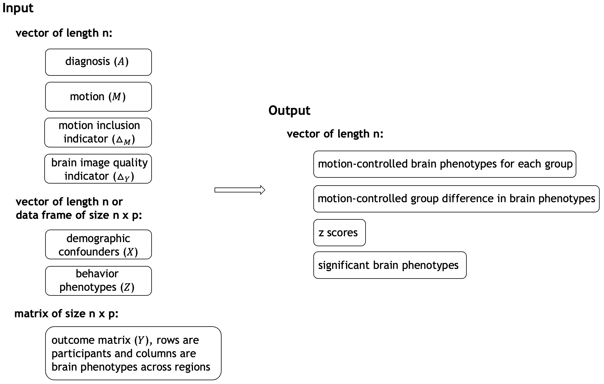

# MoCo: **Mo**tion-**Co**ntrolled Brain-Phenotype Differences Between Groups


> Nonparametric estimation of group-specific brain-phenotype means and group
> differences while accounting for motion-related selection.

MoCo is an R package for brain-imaging analyses in which motion affects both
data quality and inclusion in the analyzed sample. The package combines
one-step estimation, flexible nuisance-function learning, optional
cross-fitting, and efficient-influence-function (EIF) inference. Outcomes may
be functional-connectivity edges, regional imaging measures, or other
continuous brain phenotypes.

## Highlights

- A single high-level function, `moco()`, supports HAL, log-normal GLM, and
  GAMLSS models (generalized gamma, right-truncated when `Delta_M` is a
  threshold on motion) for conditional motion densities.
- Nuisance regressions can be estimated with Super Learner or user-specified
  GLMs.
- Cross-fitting and repeated cross-fitting are supported; repeated seeds are
  combined by averaging the estimates and the participant-level EIFs, followed
  by one simultaneous test.
- If motion `M = NULL`, a missing data method is implemented using the data availability `Delta_Y = 1`, similar to Nebel et al. (2022).
- EIF-based simultaneous confidence bands control the family-wise error rate
  (FWER) across multiple outcomes.

## Installation

Install the development version from GitHub:

```r
# install.packages("remotes")
remotes::install_github("thebrisklab/MoCo")
```

Then load the package:

```r
library(MoCo)
```

Core dependencies, including `haldensify`, are installed with MoCo. The GAMLSS
motion densities (`density_method = "gamlss"`) additionally require the
suggested packages `gamlss` and `gamlss.dist`:

```r
install.packages(c("gamlss", "gamlss.dist"))
```

Packages corresponding to optional Super Learner
wrappers—such as `glmnet`, `ranger`, and `xgboost`—are needed only when those
learners are requested. Surface plotting additionally requires `ciftiTools`
and Connectome Workbench.

## Quick start

The bundled example data `moco_example` can be used for a lightweight GLM-based analysis:

```r
library(MoCo)
data(moco_example)

fit_glm <- moco(
  X = moco_example$X,
  Z = moco_example$Z,
  A = moco_example$A,
  M = moco_example$M,
  Y = moco_example$Y,
  Delta_M = moco_example$Delta_M,
  Delta_Y = moco_example$Delta_Y,
  HAL_pMX = FALSE,
  HAL_pMXZ = FALSE,
  glm_formula = list(pMX = ".", pMXZ = "."),
  SL_library = c("SL.mean", "SL.glm", "SL.glm.interaction"),
  cross_fit = TRUE,
  cv_folds = 5,
  seed_rng = 1,
  test = TRUE,
  fwer = 0.05
)

fit_glm$est
fit_glm$adj_association
fit_glm$z_score
fit_glm$significant_regions
```

The main outputs are:

| Output | Description |
|---|---|
| `est` | Adjusted outcome means for `A = 0` and `A = 1` |
| `adj_association` | Adjusted difference, `A = 1` minus `A = 0` |
| `z_score` | EIF-based standardized statistic for each outcome (when `test = TRUE`) |
| `fwer_critical_value` | Simultaneous critical value for each requested FWER (when `test = TRUE`) |
| `significant_regions` | Simultaneous-test decisions; a vector for one FWER, a matrix with one row per FWER otherwise (when `test = TRUE`) |
| `density_log` | GAMLSS fit log, one row per seed, fold, and density (only when `density_method = "gamlss"`; `NULL` otherwise) |
| `weight_diagnostics` | Density-ratio weights `pMXD / pMXZ` in the EIF: number, maximum, and effective-sample-size ratio, one row per seed and group |

## Multiple outcomes and repeated cross-fitting

For simultaneous inference, pass all outcomes in the same `Y` matrix. MoCo
uses their joint participant-level EIF correlation structure to obtain one
simultaneous critical value at each requested FWER.

When `seed_rng` contains several seeds, MoCo runs the full analysis once per
seed and aggregates results in the following order:

1. For each seed, compute the estimates and the participant-level EIFs.
2. Average the group-specific estimates and adjusted differences across seeds.
3. Average the participant-level EIFs across seeds and recompute their
   covariance.
4. Compute the z-statistics from the averaged EIFs and run one simultaneous
   test across all outcomes.

```r
fit_repeated <- moco(
  X = moco_example$X,
  Z = moco_example$Z,
  A = moco_example$A,
  M = moco_example$M,
  Y = moco_example$Y,
  Delta_M = moco_example$Delta_M,
  Delta_Y = moco_example$Delta_Y,
  HAL_pMX = FALSE,
  HAL_pMXZ = FALSE,
  glm_formula = list(pMX = ".", pMXZ = "."),
  seed_rng = 1:10,
  fwer = c(0.05, 0.10, 0.20)
)
```

Within `moco()`, the simultaneous test is controlled by `hypo_method`
(`"mvn"`, the default, or `"multiplier"`), `hypo_n_sim` (100,000 draws by
default), `hypo_chunk_size` (draws per batch, default 1,000), and `hypo_seed`
(Monte Carlo seed, default `1`, separate from the nuisance-fitting seeds).

For one outcome, the procedure reduces to a one-dimensional EIF test. For
multiple outcomes, `hypo_test()` simulates the maximum absolute statistic from
their joint EIF correlation matrix. With `method = "mvn"` it draws from a
multivariate normal distribution with that correlation; with
`method = "multiplier"` it uses a Gaussian multiplier bootstrap of the centered
participant-level EIFs. Both target the same single-step max-|z| critical
value. Its `method`, `seed`, `n_sim`, and `chunk_size` arguments control the
simulation. Use `hypo_test()` directly only when the
estimates and participant-level EIFs have already been aggregated across
repeated seeds and covariance has been recomputed.

## Data interface



`moco()` uses the following data objects:

| Object | Role |
|---|---|
| `A` | Binary exposure or group indicator |
| `X` | Baseline covariates |
| `Z` | Post-exposure covariates used in the selection-bias adjustment |
| `M` | Continuous motion measure |
| `Y` | Continuous outcome vector or an `n` by `p` outcome matrix |
| `Delta_M` | Indicator that motion satisfies the analysis inclusion rule |
| `Delta_Y` | Indicator that the imaging outcome is observed and usable |

`A`, `X`, and `Z` must be complete. `Y` may contain missing values in rows for
which `Delta_Y = 0`. For a seed-based analysis, a seed-to-self outcome column
may be entirely missing; MoCo restores that position as `NA` in its outputs.

`Delta_M` is required and must be 0 when `M` is missing. A motion threshold
is applied by defining `Delta_M` directly, for example
`Delta_M = as.numeric(M < 0.2)`; the former `thresh` argument has been removed,
and `moco()` stops with a message if it is supplied. The definitions of
`Delta_M` and `Delta_Y` should be prespecified and reported with the analysis.

The motion densities conditional on `Delta_M = 1` are fitted on the
participants with `Delta_M = 1` and evaluated at every observed `M`, including
participants with `Delta_M = 0`. Outside the range of `M` among the
`Delta_M = 1` training participants the density is set to zero (GLM, HAL, and
untruncated GAMLSS). With `density_method = "gamlss"` and
`Delta_M_threshold = c`, the densities are right-truncated at `c` and are zero
for `M >= c`. `Delta_M` need not be determined by `M` alone (for example, a
minimum number of frames after censoring).

When motion is unavailable, set `M = NULL` (and optionally `X = NULL`) and
supply `Delta_M`; participants with `Delta_M = 0` are then treated as missing,
as in Nebel et al. (2022).

## Choosing a motion-density model

MoCo estimates two conditional motion densities, each in two versions:

- `pMX`: a density conditional on `A` and `X`, fitted on `Delta_Y = 1`;
- `pMXZ`: a density conditional on `A`, `X`, and `Z`, fitted on `Delta_Y = 1`;
- `pMXD` and `pMXZD`: the same densities among participants with
  `Delta_M = 1`, fitted on `Delta_M = 1` and evaluated at every observed `M`.

Choose their estimators with `density_method` (`"hal"`, `"glm"`, or
`"gamlss"`), or with the switches `HAL_pMX` and `HAL_pMXZ`. `HAL_pMX`
controls `pMX` and `pMXD`; `HAL_pMXZ` controls `pMXZ` and `pMXZD`. The
default `density_method = NULL` keeps the `HAL_pMX`/`HAL_pMXZ` behavior; a
supplied `density_method` overrides them.

| Method | Configuration | Use case |
|---|---|---|
| HAL | `HAL_pMX = TRUE`, `HAL_pMXZ = TRUE` (default), or `density_method = "hal"` | Flexible conditional-density estimation with minimal distributional structure (slower, nonparametric) |
| GLM | `HAL_pMX = FALSE`, `HAL_pMXZ = FALSE` and `glm_formula$pMX`/`pMXZ`, or `density_method = "glm"` | Parsimonious log-normal motion-density model (faster, but most restrictive parametric assumptions)|
| GAMLSS | `density_method = "gamlss"`, with `gamlss_options` and `Delta_M_threshold` | Flexible distributional regression for positive motion values (faster than HAL, semiparametric)|

Methods may be combined, for example `HAL_pMX = TRUE` with
`HAL_pMXZ = FALSE`, or `density_method = c(pMX = "hal", pMXZ = "gamlss")`,
although using the same method for both is generally easier to interpret and
diagnose.

### Highly adaptive lasso

HAL is the default motion-density method. Its basis-function construction and
regularization path can be controlled with `HAL_options`, which is passed to
`haldensify::haldensify()`:

```r
fit_hal <- moco(
  X = moco_example$X,
  Z = moco_example$Z,
  A = moco_example$A,
  M = moco_example$M,
  Y = moco_example$Y,
  Delta_M = moco_example$Delta_M,
  Delta_Y = moco_example$Delta_Y,
  HAL_pMX = TRUE,
  HAL_pMXZ = TRUE,
  HAL_options = list(
    max_degree = 3,
    lambda_seq = exp(seq(-1, -10, length = 100)),
    num_knots = c(1000, 500, 250)
  )
)
```

### Log-normal GLM

For GLM motion densities, set `HAL_pMX = FALSE` and `HAL_pMXZ = FALSE` and
specify the right-hand side of the `pMX` and `pMXZ` models. A value of `"."`
uses all available predictors for the corresponding density. The same formula
is used for `pMX` and `pMXD` (and for `pMXZ` and `pMXZD`).
`density_method = "glm"` is equivalent; the density formulas then default to
`"."`:

```r
fit_glm <- moco(
  X = moco_example$X,
  Z = moco_example$Z,
  A = moco_example$A,
  M = moco_example$M,
  Y = moco_example$Y,
  Delta_M = moco_example$Delta_M,
  Delta_Y = moco_example$Delta_Y,
  HAL_pMX = FALSE,
  HAL_pMXZ = FALSE,
  glm_formula = list(pMX = ".", pMXZ = ".")
)
```

### GAMLSS

GAMLSS is useful when a log-normal motion model is too restrictive.
`density_method = "gamlss"` fits all four motion densities with
`gamlss::gamlss()`, once per training fold, using the generalized gamma (`GG`)
family. `GG` has a location (`mu`), a scale (`sigma`), and a shape (`nu`)
parameter and contains the log-normal as the special case `nu = 0`. All
observed `M` must be positive.

When `Delta_M` is a threshold on motion, `Delta_M = as.numeric(M < c)`, the
`Delta_M = 1` sample is cut at `c`. Supply `Delta_M_threshold = c` so that
`pMXD` and `pMXZD` are fitted with a `GG` right-truncated at `c` (see
`?GGtr`). An untruncated `GG` fitted to a sample cut at `c` often fails to
converge or gives a badly biased density. If `Delta_M_threshold` is omitted
while every `Delta_M = 1` participant has lower motion than every
`Delta_M = 0` participant, `moco()` warns:

```
Delta_M looks like a threshold on M: every participant with Delta_M = 1 has M <= 0.1989 and every
participant with Delta_M = 0 and observed M has M >= 0.2001. If Delta_M = as.numeric(M < c), set
Delta_M_threshold = c so that pMXD and pMXZD are fitted with a right-truncated GG. ...
```

When `Delta_M` is a quality-control rule that is not a cut on `M` (for
example, a minimum number of frames after censoring), leave
`Delta_M_threshold = NULL`.

```r
fit_gamlss <- moco(
  X = moco_example$X,
  Z = moco_example$Z,
  A = moco_example$A,
  M = moco_example$M,
  Y = moco_example$Y,
  Delta_M = moco_example$Delta_M,
  Delta_Y = moco_example$Delta_Y,
  density_method = "gamlss",
  gamlss_options = list(
    mu = "linear",
    sigma = "1",
    nu = "1"
  ),
  cross_fit = TRUE,
  cv_folds = 5,
  test = TRUE,
  fwer = c(0.05, 0.20)
)
```

#### GAMLSS options

All entries of `gamlss_options` are optional:

| Entry | Description |
|---|---|
| `family` | `"GG"`, the generalized gamma (the only family currently supported); default `"GG"` |
| `mu` | `"linear"` (`A`, `X`, and, for `pMXZ`/`pMXZD`, `Z` entering linearly; default), `"smooth"` (the same, with `pb()` on the continuous covariates), or a one-sided formula |
| `sigma` | `"linear"` (default), `"smooth"`, `"1"` (intercept only), `"A"` (group only), or a one-sided formula |
| `nu` | `"1"` (constant `nu`, estimated; default) or `0` (`nu` fixed at 0, i.e. a log-normal density with the `mu` and `sigma` models above) |
| `smooth` | Names of the continuous covariates that get `pb()` when `mu` or `sigma` is `"smooth"`; `NULL` (default) uses every numeric covariate with more than 10 distinct values |
| `formula` | Optional per-density formulas, `list(pMX = , pMXD = , pMXZ = , pMXZD = )`, each a `list(mu = , sigma = , nu = )` of one-sided formulas (`nu` may be `0`); overrides the settings above for that density |
| `method` | Fitting algorithms tried in order until one converges, any of `"RS"`, `"CG"`, `"mixed"`; default `c("RS", "CG", "mixed")` |
| `n.cyc`, `c.crit` | Maximum number of outer cycles (default 500) and convergence criterion (default 0.001), passed to `gamlss.control()` |
| `nu0_fallback` | `TRUE` (default): if no algorithm converges with `nu` estimated, refit with `nu` fixed at 0 |
| `clamp` | `FALSE` (default); `TRUE` clamps the continuous covariates of prediction rows to each density's training range |
| `trace` | `FALSE` (default); `TRUE` prints the gamlss iterations |

For example, `gamlss_options = list(mu = "smooth", smooth = c("X2", "Z2"))`
gives the location model `A + X1 + pb(X2) + X3 + Z1 + pb(Z2) + Z3 + Z4` for
`pMXZ`, and
`formula = list(pMXZ = list(mu = ~ A + X1 + pb(X2) + Z2, sigma = ~ A))` sets
the `pMXZ` model directly. With `nu = 0` and `sigma = "1"`, the GAMLSS fit is
essentially the log-normal GLM.

Each density is fitted with the algorithms in `method`, in order, until one
converges. If none converges with `nu` estimated and `nu0_fallback = TRUE`, the
fit is repeated with `nu` fixed at 0. If that also fails, the log-normal GLM
density is used for that component, with a warning. The algorithm used,
whether `nu` was fixed, truncation, convergence, the number of iterations, the
fitted `nu`, the sample size, and whether a fallback was needed are recorded
for each seed, fold, and density in `density_log`. `weight_diagnostics`
summarizes the density-ratio weights `pMXD / pMXZ` that enter the EIF, and
`moco()` warns when their effective-sample-size ratio is below 0.1 for either
group.

## Tutorial: an ABIDE-like seed-based analysis

The bundled data `moco_example` contain 400 simulated children aged 8 to 14
years and reproduce the layout of a seed-based analysis motivated by the Autism
Brain Imaging Data Exchange (ABIDE). The seed is the default mode network (DMN),
and the outcomes represent its Fisher-z-transformed functional connectivity
with networks from the Yeo seven-network parcellation.

```r
library(MoCo)
data(moco_example)
str(moco_example)
```

The simulated objects are:

- `A`: diagnostic group, coded 1 for ASD (153 children) and 0 for non-ASD;
- `M`: mean framewise displacement (mm), generated from a generalized gamma
  distribution whose location and spread are larger in ASD, at higher ADOS
  scores and at younger ages, so motion in the ASD group is higher and more
  right-skewed than log-normal;
- `Delta_M`: motion inclusion; the probability of passing motion quality
  control falls smoothly with `M` (it is not a fixed cut-off), and 79% of
  children pass (88% non-ASD, 65% ASD);
- `Delta_Y`: imaging-data availability and quality (93% available);
- `X`: sex, age, and handedness;
- `Z`: ADOS, full-scale IQ, stimulant medication, and nonstimulant medication;
- `Y`: an `n` by 7 functional-connectivity matrix with columns Visual,
  Somatomotor, DorsalAttention, VentralAttention, Limbic, Frontoparietal, and
  Default.

The seventh column of `Y` is the seed-to-self position and is therefore
entirely `NA`. Rows with `Delta_Y = 0` are also missing because their imaging
outcomes are unavailable. The simulated group differences are zero for the
first four outcomes, -0.0485 for the fifth (Limbic), and -0.0682 for the sixth
(Frontoparietal). The generating script is installed with the package: `system.file("scripts", "moco_example.R", package = "MoCo")`.

All three fits below use the default Super Learner library for the nuisance
regressions, five-fold cross-fitting, and simultaneous tests at FWER 0.05; only
the motion-density model differs.

### Log-normal GLM

```r
fit_abide <- moco(
  X = moco_example$X,
  Z = moco_example$Z,
  A = moco_example$A,
  M = moco_example$M,
  Y = moco_example$Y,
  Delta_M = moco_example$Delta_M,
  Delta_Y = moco_example$Delta_Y,
  density_method = "glm",
  cross_fit = TRUE,
  cv_folds = 5,
  seed_rng = 1,
  test = TRUE,
  fwer = 0.05
)
```

The adjusted means are stored in `est`. The first row represents `A = 0`, the
second represents `A = 1`, and the structural seventh column is restored as
`NA`:

```r
round(fit_abide$est, 4)
# est_A0 -0.2845 -0.1102 -0.1357 -0.0008  0.1090  0.1796 NA
# est_A1 -0.2871 -0.1572 -0.1008  0.0658  0.0236  0.1024 NA
```

The adjusted group differences are:

```r
round(fit_abide$adj_association, 4)
# -0.0026 -0.0471  0.0349  0.0667 -0.0854 -0.0772 NA
```

The EIF-based test results are:

```r
round(fit_abide$z_score, 4)
# -0.0981 -1.5245  1.2608  2.0033 -2.7918 -2.9241 NA

fit_abide$significant_regions
# FALSE FALSE FALSE FALSE TRUE TRUE NA
```

The density-ratio weights `pMXD / pMXZ` show that the log-normal model fits
the skewed motion of the ASD group poorly: a few ASD children receive large
weights, and the effective sample size of that group drops to 26%:

```r
fit_abide$weight_diagnostics
#   seed group   n max_weight ess_ratio
# 1    1    A0 235      1.345     0.977
# 2    1    A1 136     24.001     0.259
```

The numerical output above is illustrative; results may vary slightly with R,
dependency, and numerical-optimization versions.

### GAMLSS

The same analysis with GAMLSS motion densities uses
`density_method = "gamlss"` and a generalized gamma (`GG`) distribution. Age
(`X2`) and IQ (`Z2`) enter the location through penalized splines `pb()` and
the other covariates linearly; the scale depends linearly on all covariates,
and the shape `nu` is estimated. `Delta_M` is not a cut on `M` in these data,
so `Delta_M_threshold` is not set:

```r
fit_abide_gamlss <- moco(
  X = moco_example$X,
  Z = moco_example$Z,
  A = moco_example$A,
  M = moco_example$M,
  Y = moco_example$Y,
  Delta_M = moco_example$Delta_M,
  Delta_Y = moco_example$Delta_Y,
  density_method = "gamlss",
  gamlss_options = list(mu = "smooth", smooth = c("X2", "Z2"), sigma = "linear"),
  cross_fit = TRUE,
  cv_folds = 5,
  seed_rng = 1,
  test = TRUE,
  fwer = 0.05
)

round(fit_abide_gamlss$est, 4)
# est_A0 -0.2776 -0.1157 -0.1358  0.0033  0.1028  0.1740 NA
# est_A1 -0.2676 -0.1166 -0.0962  0.0143  0.0402  0.1007 NA

round(fit_abide_gamlss$adj_association, 4)
#  0.0100 -0.0008  0.0396  0.0110 -0.0626 -0.0733 NA

round(fit_abide_gamlss$z_score, 4)
#  0.4924 -0.0333  2.2241  0.4891 -2.6410 -3.1166 NA

fit_abide_gamlss$significant_regions
# FALSE FALSE FALSE FALSE TRUE TRUE NA
```

The fit of each density in each fold is recorded in `density_log` (20 rows
here: 5 folds by 4 densities); all fits converged with `RS`, without a
fallback, and the weights stay small in both groups:

```r
head(fit_abide_gamlss$density_log[, c("fold", "density", "method", "truncated", "converged", "nu", "n")], 4)
#   fold density method truncated converged      nu   n
# 1    1     pMX     RS     FALSE      TRUE  0.3627 295
# 2    1    pMXD     RS     FALSE      TRUE  0.1313 251
# 3    1    pMXZ     RS     FALSE      TRUE  0.3780 295
# 4    1   pMXZD     RS     FALSE      TRUE -0.0603 251

fit_abide_gamlss$weight_diagnostics
#   seed group   n max_weight ess_ratio
# 1    1    A0 235      1.649     0.959
# 2    1    A1 136      3.772     0.588
```

Other models are set in the same list, globally or per density. For example,
`sigma = "A"` lets the scale differ by group only, which is more stable when
one group is small, and `nu = 0` with `sigma = "1"` gives essentially the
log-normal GLM above (not run):

```r
gamlss_options = list(
  mu = "smooth", smooth = c("X2", "Z2"),
  sigma = "A", nu = "1",
  n.cyc = 500
)
```

A covariate-dependent scale can extrapolate in a small group. In 100
simulated data sets of this design, `sigma = "linear"` gave extreme weights in
about 1 in 10, and `sigma = "A"` removed them. Check `density_log` and
`weight_diagnostics` before interpreting the results.

### HAL

The same analysis with HAL motion densities uses `density_method = "hal"`. The
default `HAL_options` are computationally heavy; this example uses a lighter
basis (second-order interactions, 38 penalty values, and at most 30, 10, and 5
knots):

```r
fit_abide_hal <- moco(
  X = moco_example$X,
  Z = moco_example$Z,
  A = moco_example$A,
  M = moco_example$M,
  Y = moco_example$Y,
  Delta_M = moco_example$Delta_M,
  Delta_Y = moco_example$Delta_Y,
  density_method = "hal",
  HAL_options = list(
    max_degree = 2,
    lambda_seq = exp(seq(-1, -10, length = 40))[1:38],
    num_knots = c(30, 10, 5)
  ),
  cross_fit = TRUE,
  cv_folds = 5,
  seed_rng = 1,
  test = TRUE,
  fwer = 0.05
)

round(fit_abide_hal$est, 4)
# est_A0 -0.2964 -0.1145 -0.1414 -0.0024  0.1092  0.1861 NA
# est_A1 -0.2691 -0.1226 -0.1056  0.0296  0.0253  0.0986 NA

round(fit_abide_hal$adj_association, 4)
#  0.0273 -0.0081  0.0358  0.0321 -0.0839 -0.0875 NA

round(fit_abide_hal$z_score, 4)
#  1.3559 -0.3329  1.9755  1.5330 -3.7638 -4.1397 NA

fit_abide_hal$significant_regions
# FALSE FALSE FALSE FALSE TRUE TRUE NA

fit_abide_hal$weight_diagnostics
#   seed group   n max_weight ess_ratio
# 1    1    A0 235      2.915     0.928
# 2    1    A1 136      3.142     0.624
```

With the default Super Learner library, the nuisance regressions take most of
the run time: the GLM and GAMLSS fits each took about 14 minutes and the HAL
fit about 21 minutes (one core each). HAL fitting time grows quickly with the
sample size, the number of covariates, `max_degree`, and `num_knots`, so HAL
can be slow for large samples.

### Comparison

Adjusted associations (`adj_association`), z-statistics, simultaneous tests at
FWER 0.05, and the accuracy and stability of the density-ratio weights for the
three motion-density models on the example data (seed 1, five folds):

| Outcome | Truth | GLM | GAMLSS (GG, smooth mu, linear sigma) | HAL |
|---|---|---|---|---|
| 1 Visual | 0 | -0.0026 (z = -0.10) | 0.0100 (0.49) | 0.0273 (1.36) |
| 2 Somatomotor | 0 | -0.0471 (-1.52) | -0.0008 (-0.03) | -0.0081 (-0.33) |
| 3 Dorsal attention | 0 | 0.0349 (1.26) | 0.0396 (2.22) | 0.0358 (1.98) |
| 4 Ventral attention | 0 | 0.0667 (2.00) | 0.0110 (0.49) | 0.0321 (1.53) |
| 5 Limbic | -0.0485 | **-0.0854 (-2.79)** | **-0.0626 (-2.64)** | **-0.0839 (-3.76)** |
| 6 Frontoparietal | -0.0682 | **-0.0772 (-2.92)** | **-0.0733 (-3.12)** | **-0.0875 (-4.14)** |
| Critical value | | 2.583 | 2.580 | 2.582 |
| RMSE (six outcomes) | | 0.039 | 0.018 | 0.028 |
| Largest weight, ASD | | 24.0 | 3.8 | 3.1 |
| ESS ratio, ASD | | 0.26 | 0.59 | 0.62 |
| Approximate density fit time | | a few seconds | about 20 s | about 7-8 min |
| Total run time | | 14 min | 14 min | 21 min |

Bold marks outcomes significant at FWER 0.05. Total run time is for the whole `moco()` call with the default Super Learner library; the approximate density fit time is the extra time each density model adds, estimated from the differences in total run time and from runs of the same design with a compact library (`SL.mean`, `SL.glm`, `SL.glm.interaction`). All three models detect the
fifth and sixth outcomes and no null outcome. GAMLSS is the most accurate and,
like HAL, keeps the density-ratio weights small; the log-normal GLM gives one
ASD child a weight of 24, which pulls the estimates away from the truth, most
visibly for the null fourth outcome (0.067). GAMLSS takes about the same time
as GLM.

### Which method?

- **Log-normal GLM**: motion that is close to log-normal; fastest.
- **GAMLSS**: skewed or heteroscedastic motion (`GG`); as accurate as HAL at
  close to GLM cost. Set `Delta_M_threshold` when `Delta_M` is a cut on motion,
  start with a simple `sigma` model (`"A"` or `"1"`) when a group is small, and
  check `density_log` and `weight_diagnostics` before interpreting the results.
- **HAL**: the most flexible, with minimal distributional assumptions and the theoretical guarantees of the nonparametric estimator; slow.
- Whichever model is used, report it with the analysis and check that the conclusions are robust to the choice.

## Function reference

The complete function documentation is available from R:

```r
?moco
?hypo_test
?plot_moco
?GGtr
```

<details>
<summary><strong>Complete <code>moco()</code> interface</strong></summary>

```r
moco(
  X, Z, A, M, Y,
  Delta_M,
  Delta_Y,
  SL_library = c(
    "SL.earth", "SL.glmnet", "SL.gam", "SL.glm",
    "SL.glm.interaction", "SL.step", "SL.step.interaction",
    "SL.xgboost", "SL.ranger", "SL.mean"
  ),
  SL_library_customize = list(
    gA = NULL, gDM = NULL, gDY_AX = NULL, gDY_AXZ = NULL,
    mu_AMXZ = NULL, eta_AXZ = NULL, eta_AXM = NULL, xi_AX = NULL
  ),
  glm_formula = list(
    gA = NULL, gDM = NULL, gDY_AX = NULL, gDY_AXZ = NULL,
    mu_AMXZ = NULL, eta_AXZ = NULL, eta_AXM = NULL, xi_AX = NULL,
    pMX = NULL, pMXZ = NULL
  ),
  HAL_pMX = TRUE,
  HAL_pMXZ = TRUE,
  HAL_options = list(
    max_degree = 3,
    lambda_seq = exp(seq(-1, -10, length = 100)),
    num_knots = c(1000, 500, 250)
  ),
  density_method = NULL,
  Delta_M_threshold = NULL,
  gamlss_options = NULL,
  cross_fit = TRUE,
  cv_folds = 5,
  test = TRUE,
  fwer = 0.05,
  seed_rng = 1,
  hypo_method = "mvn",
  hypo_n_sim = 100000L,
  hypo_chunk_size = 1000L,
  hypo_seed = 1,
  ...
)
```

### Nuisance-model components

`SL_library_customize` and `glm_formula` may configure the following nuisance
functions separately:

| Component | Target |
|---|---|
| `gA` | Propensity score, `P(A = 1 | X)` |
| `gDM` | Motion inclusion, `P(Delta_M = 1 | A, X)` |
| `gDY_AX` | Outcome observation, `P(Delta_Y = 1 | A, X)` |
| `gDY_AXZ` | Outcome observation, `P(Delta_Y = 1 | A, X, Z)` |
| `mu_AMXZ` | Outcome regression, `E(Y | Delta_Y = 1, A, M, X, Z)` |
| `eta_AXZ` | Pseudo-outcome regression conditional on `A`, `X`, and `Z` |
| `eta_AXM` | Pseudo-outcome regression conditional on `A`, `M`, and `X` |
| `xi_AX` | Regression of `eta_AXZ` conditional on `A` and `X` |
| `pMX` | Log-normal GLM motion density conditional on `A` and `X` (`glm_formula` only; also used for `pMXD`) |
| `pMXZ` | Log-normal GLM motion density conditional on `A`, `X`, and `Z` (`glm_formula` only; also used for `pMXZD`) |

### Other controls

| Argument | Description |
|---|---|
| `SL_library` | Common Super Learner library for nuisance regressions; if `NULL`, the libraries in `SL_library_customize` are used |
| `SL_library_customize` | Separate libraries for `gA`, `gDM`, `gDY_AX`, `gDY_AXZ`, `mu_AMXZ`, `eta_AXZ`, `eta_AXM`, and `xi_AX` |
| `glm_formula` | Right-hand-side formulas for nuisance GLMs and GLM motion densities |
| `HAL_pMX` | Whether `pMX` and `pMXD` use HAL (`TRUE`) or the log-normal GLM (`FALSE`) |
| `HAL_pMXZ` | Whether `pMXZ` and `pMXZD` use HAL (`TRUE`) or the log-normal GLM (`FALSE`) |
| `HAL_options` | HAL basis and regularization controls (`max_degree`, `lambda_seq`, `num_knots`) |
| `density_method` | `"hal"`, `"glm"`, or `"gamlss"` for all four motion densities, or `c(pMX = , pMXZ = )`; `NULL` (default) uses `HAL_pMX`/`HAL_pMXZ` |
| `Delta_M_threshold` | With `density_method = "gamlss"`: the cut `c` when `Delta_M = as.numeric(M < c)`; `pMXD` and `pMXZD` are then right-truncated at `c` |
| `gamlss_options` | GAMLSS specification (see GAMLSS options); `NULL` (default) uses the defaults |
| `cross_fit` | Whether to use cross-fitting |
| `cv_folds` | Number of cross-fitting folds |
| `seed_rng` | Nuisance-fitting and cross-fitting seed or seeds |
| `test` | Whether to run simultaneous EIF inference |
| `fwer` | Requested family-wise error rates |
| `hypo_method` | Critical-value simulation: `"mvn"` (default) or `"multiplier"` |
| `hypo_n_sim` | Number of Gaussian draws for the simultaneous test (default 100,000) |
| `hypo_chunk_size` | Draws processed per simulation batch (default 1,000) |
| `hypo_seed` | Critical-value simulation seed, separate from the nuisance-fitting seeds (default 1) |

</details>

## Reproducibility and diagnostics

- Use named columns in `X` and `Z`, especially for GAMLSS.
- Save analysis-cohort IDs and preserve their order across outcomes and seeds.
- Define `Delta_M` and `Delta_Y` explicitly in the analysis script.
- Use the same outcome family when comparing simultaneous tests across methods.
- Save the R version, package versions, learner library, fold count, and seeds.
- Examine GAMLSS convergence and distributional diagnostics before interpreting
  GAMLSS-based results, and report how many fits used a fallback
  (`density_log$fallback`, `density_log$method`, and `density_log$nu_fixed`).
- Check positivity: summarise the propensities (`gA`, `gDM`, `gDY_AXZ`) and the
  density ratios used in the influence function (`weight_diagnostics`),
  including participants with `Delta_M = 0`, at whose motion values the
  `Delta_M = 1` densities are also evaluated.
- In distributed analyses, save estimates and participant-level EIFs for every
  outcome and seed, then aggregate them before calculating covariance and test
  statistics.

## Related software and resources

- [SuperLearner](https://github.com/ecpolley/SuperLearner): ensemble learning
  for nuisance-function estimation.
- [haldensify](https://github.com/nhejazi/haldensify): highly adaptive lasso
  conditional-density estimation.
- [gamlss](https://github.com/gamlss-dev/gamlss): generalized additive models
  for location, scale, and shape.
- [Bethlehem et al. (2022)](https://doi.org/10.1038/s41586-022-04554-y):
  brain charts fitted with generalized-gamma GAMLSS, the basis of the default
  `GG` family.
- [ABIDE](https://doi.org/10.1038/mp.2013.78): motivating neuroimaging
  data resource for the bundled simulation.
- [Yeo seven-network parcellation](https://doi.org/10.1152/jn.00338.2011):
  network definition used in the tutorial.
