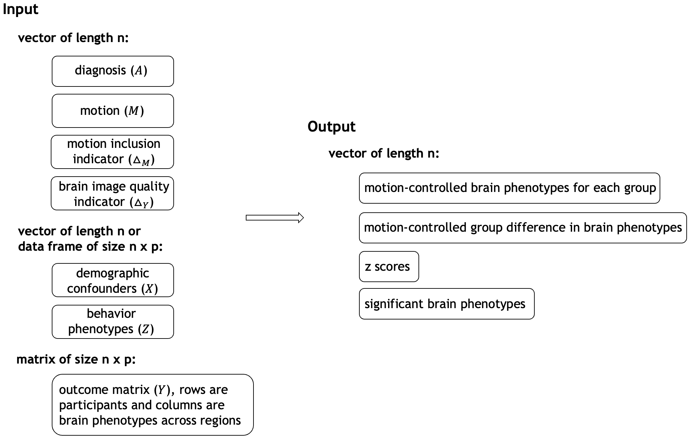

# MoCo: **Mo**tion-**Co**ntrolled Brain-Phenotype Differences Between Groups


> Nonparametric estimation of group-specific brain-phenotype means and group
> differences while accounting for motion-related selection.

MoCo is an R package for brain-imaging analyses in which motion affects both
data quality and inclusion in the analyzed sample. The package combines
one-step estimation, flexible nuisance-function learning, optional
cross-fitting, and efficient-influence-function (EIF) inference. Outcomes may
be functional-connectivity edges, regional imaging measures, or other
continuous brain phenotypes.

## Highlights

- A single high-level function, `moco()`, supports HAL, log-normal GLM, and
  GAMLSS models (any `gamlss.dist` family on the positive real line, generalized
  gamma by default) for conditional motion densities.
- Nuisance regressions can be estimated with Super Learner or user-specified
  GLMs.
- Cross-fitting and repeated cross-fitting are supported; repeated seeds are
  combined by averaging estimates, z-statistics, and critical values.
- If motion `M = NULL`, a missing data method is implemented using the data availability `Delta_Y = 1`, similar to Nebel et al. (2022).
- EIF-based simultaneous confidence bands control the family-wise error rate
  (FWER) across multiple outcomes.

## Installation

Install the development version from GitHub:

```r
# install.packages("remotes")
remotes::install_github("thebrisklab/MoCo")
```

Then load the package:

```r
library(MoCo)
```

Core dependencies, including `haldensify`, `gamlss`, and `gamlss.dist`, are
installed with MoCo. Packages corresponding to optional Super Learner
wrappers—such as `glmnet`, `ranger`, and `xgboost`—are needed only when those
learners are requested. Surface plotting additionally requires `ciftiTools`
and Connectome Workbench.

## Quick start

The bundled example data can be used for a lightweight GLM-based analysis:

```r
library(MoCo)
data(data)

fit_glm <- moco(
  X = data$X,
  Z = data$Z,
  A = data$A,
  M = data$M,
  Y = data$Y,
  Delta_M = data$Delta_M,
  Delta_Y = data$Delta_Y,
  HAL_pMX = FALSE,
  HAL_pMXZ = FALSE,
  glm_formula = list(pMX = ".", pMXZ = "."),
  SL_library = c("SL.mean", "SL.glm", "SL.glm.interaction"),
  cross_fit = TRUE,
  cv_folds = 5,
  seed_rng = 1,
  test = TRUE,
  fwer = 0.05
)

fit_glm$est
fit_glm$adj_association
fit_glm$z_score
fit_glm$significant_regions
```

The main outputs are:

| Output | Description |
|---|---|
| `est` | Adjusted outcome means for `A = 0` and `A = 1` |
| `adj_association` | Adjusted difference, `A = 1` minus `A = 0` |
| `z_score` | EIF-based standardized statistic for each outcome (when `test = TRUE`) |
| `fwer_critical_value` | Simultaneous critical value for each requested FWER (when `test = TRUE`) |
| `significant_regions` | Simultaneous-test decisions; a vector for one FWER, a matrix with one row per FWER otherwise (when `test = TRUE`) |
| `gamlss_info` | GAMLSS fit summaries, one row per seed, fold, and density (only when `gamlss_options` is supplied) |

## Multiple outcomes and repeated cross-fitting

For simultaneous inference, pass all outcomes in the same `Y` matrix. MoCo
uses their joint participant-level EIF correlation structure to obtain one
simultaneous critical value at each requested FWER.

When `seed_rng` contains several seeds, MoCo runs the full analysis once per
seed and aggregates results in the following order:

1. For each seed, compute the estimates, the participant-level EIFs, their
   covariance, the z-statistics, and the simultaneous critical values.
2. Average the group-specific estimates and adjusted differences across seeds.
3. Average the z-statistics and the critical values across seeds.
4. Compare the averaged |z| with the averaged critical value.

```r
fit_repeated <- moco(
  X = data$X,
  Z = data$Z,
  A = data$A,
  M = data$M,
  Y = data$Y,
  Delta_M = data$Delta_M,
  Delta_Y = data$Delta_Y,
  HAL_pMX = FALSE,
  HAL_pMXZ = FALSE,
  glm_formula = list(pMX = ".", pMXZ = "."),
  seed_rng = 1:10,
  fwer = c(0.05, 0.10, 0.20)
)
```

Within `moco()`, the simultaneous test uses a fixed Monte Carlo seed (`1`) and
100,000 multivariate-normal draws, generated in chunks of 25,000.

For one outcome, the procedure reduces to a one-dimensional EIF test. For
multiple outcomes, `hypo_test()` simulates the maximum absolute statistic from
their joint EIF correlation matrix; its `seed`, `n_sim`, and `chunk_size`
arguments control the simulation. Use `hypo_test()` directly only when the
estimates and participant-level EIFs have already been aggregated across
repeated seeds and covariance has been recomputed.

## Data interface



`moco()` uses the following data objects:

| Object | Role |
|---|---|
| `A` | Binary exposure or group indicator |
| `X` | Baseline covariates |
| `Z` | Post-exposure covariates used in the selection-bias adjustment |
| `M` | Continuous motion measure |
| `Y` | Continuous outcome vector or an `n` by `p` outcome matrix |
| `Delta_M` | Indicator that motion satisfies the analysis inclusion rule |
| `Delta_Y` | Indicator that the imaging outcome is observed and usable |

`A`, `X`, and `Z` must be complete. `Y` may contain missing values in rows for
which `Delta_Y = 0`. For a seed-based analysis, a seed-to-self outcome column
may be entirely missing; MoCo restores that position as `NA` in its outputs.

`Delta_M` can be supplied directly or constructed inside `moco()` by supplying
`thresh`, in which case `Delta_M = 1` if `M < thresh` (and `0` if `M` is
missing); a supplied `Delta_M` is then ignored. The definitions of `Delta_M`
and `Delta_Y` should be prespecified and reported with the analysis.

The motion densities conditional on `Delta_M = 1` are fitted on the
participants with `Delta_M = 1` and evaluated at every observed `M`, including
participants with `Delta_M = 0`; MoCo does not set them to zero where
`Delta_M = 0`. The results are therefore the same whether `Delta_M` is
supplied or built from `thresh`, and `Delta_M` need not be determined by `M`
alone (for example, a minimum number of frames after censoring).

When motion is unavailable, set `M = NULL` (and optionally `X = NULL`) and
supply `Delta_M`; participants with `Delta_M = 0` are then treated as missing,
as in Nebel et al. (2022).

## Choosing a motion-density model

MoCo estimates two conditional motion densities, each in two versions:

- `pMX`: a density conditional on `A` and `X`, fitted on `Delta_Y = 1`;
- `pMXZ`: a density conditional on `A`, `X`, and `Z`, fitted on `Delta_Y = 1`;
- `pMXD` and `pMXZD`: the same densities among participants with
  `Delta_M = 1`, fitted on `Delta_M = 1` and evaluated at every observed `M`.

Choose their estimators with `HAL_pMX`, `HAL_pMXZ`, `glm_formula`, and
`gamlss_options`. `HAL_pMX` controls `pMX` and `pMXD`; `HAL_pMXZ` controls
`pMXZ` and `pMXZD`. When `gamlss_options` is supplied, GAMLSS is used for all
four densities and the HAL/GLM settings are ignored for them.

| Method | Configuration | Use case |
|---|---|---|
| HAL | `HAL_pMX = TRUE`, `HAL_pMXZ = TRUE` (default) | Flexible conditional-density estimation with minimal distributional structure (slower, nonparametric) |
| GLM | `HAL_pMX = FALSE`, `HAL_pMXZ = FALSE` and `glm_formula$pMX`/`pMXZ` | Parsimonious log-normal motion-density model (faster, but most restrictive parametric assumptions)|
| GAMLSS | `gamlss_options = list(...)` | Flexible distributional regression for positive motion values (faster than HAL, semiparametric)|

HAL and GLM may be combined (for example, `HAL_pMX = TRUE` with
`HAL_pMXZ = FALSE`), although using the same method for both is generally
easier to interpret and diagnose.

### Highly adaptive lasso

HAL is the default motion-density method. Its basis-function construction and
regularization path can be controlled with `HAL_options`, which is passed to
`haldensify::haldensify()`:

```r
fit_hal <- moco(
  X = data$X,
  Z = data$Z,
  A = data$A,
  M = data$M,
  Y = data$Y,
  Delta_M = data$Delta_M,
  Delta_Y = data$Delta_Y,
  HAL_pMX = TRUE,
  HAL_pMXZ = TRUE,
  HAL_options = list(
    max_degree = 3,
    lambda_seq = exp(seq(-1, -10, length = 100)),
    num_knots = c(1000, 500, 250)
  )
)
```

### Log-normal GLM

For GLM motion densities, set `HAL_pMX = FALSE` and `HAL_pMXZ = FALSE` and
specify the right-hand side of the `pMX` and `pMXZ` models. A value of `"."`
uses all available predictors for the corresponding density. The same formula
is used for `pMX` and `pMXD` (and for `pMXZ` and `pMXZD`):

```r
fit_glm <- moco(
  X = data$X,
  Z = data$Z,
  A = data$A,
  M = data$M,
  Y = data$Y,
  Delta_M = data$Delta_M,
  Delta_Y = data$Delta_Y,
  HAL_pMX = FALSE,
  HAL_pMXZ = FALSE,
  glm_formula = list(pMX = ".", pMXZ = ".")
)
```

### GAMLSS

GAMLSS is useful when a log-normal motion model is too restrictive. Supplying
`gamlss_options` fits all four motion densities with `gamlss::gamlss()`, once
per training fold. Any `gamlss.dist` family that is continuous on (0, ∞) may
be used (for example `LOGNO`, `GA`, `GG`, `BCCGo`, `BCPEo`, `BCTo`); the
default is the generalized gamma (`GG`). All observed `M` must be positive. With
`family = "LOGNO"` and `formulas = list(mu = "linear", sigma = "1")`, the
GAMLSS fit reproduces the log-normal GLM up to numerical precision.

The example below fits the default `GG` family with all covariates entering the
location linearly and constant scale and shape (not run: on the small bundled
example `GG` does not converge; see the Tutorial):

```r
fit_gamlss <- moco(
  X = data$X,
  Z = data$Z,
  A = data$A,
  M = data$M,
  Y = data$Y,
  Delta_M = data$Delta_M,
  Delta_Y = data$Delta_Y,
  gamlss_options = list(
    family = "GG",
    formulas = list(mu = "linear", sigma = "1", nu = "1")
  ),
  cross_fit = TRUE,
  cv_folds = 5,
  test = TRUE,
  fwer = c(0.05, 0.20)
)
```

#### GAMLSS options

All entries of `gamlss_options` are optional:

| Entry | Description |
|---|---|
| `family` | A `gamlss.dist` family name, function, or object, or a list by density (`pMX`, `pMXD`, `pMXZ`, `pMXZD`) with a `default`; must be continuous on (0, ∞); default `"GG"` |
| `formulas` | List of `mu`, `sigma`, `nu`, `tau`; each a formula, a string, or a keyword: `"linear"` (`A`, `X`, and, for `pMXZ`/`pMXZD`, `Z` entering linearly), `"pb"` (the same, with `pb()` on numeric columns with at least 10 distinct values), or `"1"` (intercept only). `.` expands to all available columns. Defaults: `mu = "linear"`, others `"1"`. Per-density lists are allowed |
| `method` | Fitting algorithm: `"RS()"` (default), `"CG()"`, or `"mixed(1, 50)"`, as a string or a call |
| `control` | List of `gamlss.control()` arguments, e.g. `n.cyc` (default 200), `c.crit`, `trace` (default `FALSE`) |
| `i.control` | List of `glim.control()` arguments |
| `weights`, `mu.start`, `sigma.start`, `nu.start`, `tau.start` | Scalars or length-`n` vectors (subset to each fold's fitting rows) |
| `mu.fix`, `sigma.fix`, `nu.fix`, `tau.fix` | Keep a parameter fixed at its starting value |
| `args` | Named list of further arguments forwarded to `gamlss::gamlss()` |
| `start` | `"auto"` (default; Box-Cox families start from the log-normal fit) or `"default"` |
| `retry` | `TRUE` (default) or `FALSE`; see below |
| `clamp` | `TRUE` (default): continuous covariates of prediction rows are clamped to each density's training range; `FALSE` turns this off |
| `on_nonconvergence` | `"stop"` (default): stop with an error that names the density, family, and fold and suggests other families; `"warn"`: warn and use the non-converged fit |
| `pMX`, `pMXD`, `pMXZ`, `pMXZD` | Per-density override lists with any of the entries above |

If a GAMLSS fit fails or does not converge and `retry = TRUE`, the same model
is refitted starting from the intercept-only `sigma`/`nu`/`tau` fit, then with
`CG()`, then with `RS()` if another method was requested. Only the numerical
algorithm changes. The family, formulas, fit statistics (deviance, AIC, SBC),
convergence, algorithm, and number of clamped values for each density, fold,
and seed are recorded in `gamlss_info`. If a fit still fails, `moco()` stops
by default, for example:

```
GAMLSS density pMXZD (family GG, fold 1) did not converge in 200 cycles. It was fitted on the 198 rows with Delta_M = 1.
Try another family for this density, e.g. gamlss_options = list(family = list(default = "GG", pMXZD = "LOGNO")).
```

## Tutorial: an ABIDE-like seed-based analysis

The bundled data contain 400 simulated participants and reproduce the layout
of a seed-based analysis motivated by the Autism Brain Imaging Data Exchange
(ABIDE). The seed is the default mode network (DMN), and the outcomes represent
its Fisher-z-transformed functional connectivity with networks from the Yeo
seven-network parcellation.

```r
library(MoCo)
data(data)
str(data)
```

The simulated objects are:

- `A`: diagnostic group, coded 1 for ASD and 0 for non-ASD;
- `M`: mean framewise displacement;
- `Delta_M`: motion inclusion, with high motion defined in the simulation as
  mean FD greater than 0.2;
- `Delta_Y`: imaging-data availability and quality;
- `X`: sex, age, and handedness;
- `Z`: ADOS, full-scale IQ, stimulant medication, and nonstimulant medication;
- `Y`: an `n` by 7 functional-connectivity matrix.

The seventh column of `Y` is the seed-to-self position and is therefore
entirely `NA`. Rows with `Delta_Y = 0` are also missing because their imaging
outcomes are unavailable. The simulated group differences are zero for the
first four outcomes, -0.0485 for the fifth, and -0.0682 for the sixth.

### Log-normal GLM

For a fast illustration, fit log-normal GLM motion densities and a compact
Super Learner library:

```r
fit_abide <- moco(
  X = data$X,
  Z = data$Z,
  A = data$A,
  M = data$M,
  Y = data$Y,
  Delta_M = data$Delta_M,
  Delta_Y = data$Delta_Y,
  SL_library = c("SL.mean", "SL.glm", "SL.glm.interaction"), 
  glm_formula = list(pMX = ".", pMXZ = "."),
  HAL_pMX = FALSE,
  HAL_pMXZ = FALSE,
  cross_fit = TRUE,
  cv_folds = 5,
  seed_rng = 1,
  test = TRUE,
  fwer = 0.05
)
```

The adjusted means are stored in `est`. The first row represents `A = 0`, the
second represents `A = 1`, and the structural seventh column is restored as
`NA`:

```r
round(fit_abide$est, 4)
# est_A0 -0.2191 -0.1640 -0.1819  0.0528  0.0399  0.0862 NA
# est_A1 -0.2192 -0.1617 -0.1809  0.0491 -0.0079  0.0167 NA
```

The adjusted group differences are:

```r
round(fit_abide$adj_association, 4)
# -0.0001  0.0024  0.0010 -0.0037 -0.0478 -0.0696 NA
```

The EIF-based test results are:

```r
round(fit_abide$z_score, 4)
# -0.0052  0.0879  0.0404 -0.1538 -1.9283 -3.3178 NA

fit_abide$significant_regions
# FALSE FALSE FALSE FALSE FALSE TRUE NA
```

The numerical output above is illustrative; results may vary slightly with R,
dependency, and numerical-optimization versions.

### GAMLSS

The same analysis with GAMLSS motion densities replaces `HAL_pMX`,
`HAL_pMXZ`, and the density formulas in `glm_formula` with `gamlss_options`.
With the default `GG` family for all four densities, the fit stops on this
small example: the densities fitted on `Delta_M = 1` use about 200
participants per training fold, all with motion below 0.2, and `GG` does not
converge for them. The example therefore keeps `GG` for the densities fitted on
`Delta_Y = 1` (`pMX`, `pMXZ`) and uses the log-normal family for the two
densities fitted on `Delta_M = 1` (`pMXD`, `pMXZD`), with all covariates
entering the location linearly and constant scale and shape:

```r
fit_abide_gamlss <- moco(
  X = data$X,
  Z = data$Z,
  A = data$A,
  M = data$M,
  Y = data$Y,
  Delta_M = data$Delta_M,
  Delta_Y = data$Delta_Y,
  SL_library = c("SL.mean", "SL.glm", "SL.glm.interaction"),
  gamlss_options = list(
    family = list(default = "GG", pMXD = "LOGNO", pMXZD = "LOGNO"),
    formulas = list(mu = "linear", sigma = "1", nu = "1")
  ),
  cross_fit = TRUE,
  cv_folds = 5,
  seed_rng = 1,
  test = TRUE,
  fwer = 0.05
)

round(fit_abide_gamlss$est, 4)
# est_A0 -0.2202 -0.1629 -0.1806  0.0516  0.0413  0.0880 NA
# est_A1 -0.2180 -0.1593 -0.1776  0.0510 -0.0055  0.0199 NA

round(fit_abide_gamlss$adj_association, 4)
#  0.0022  0.0036  0.0030 -0.0006 -0.0467 -0.0681 NA

round(fit_abide_gamlss$z_score, 4)
#  0.0865  0.1340  0.1222 -0.0235 -1.9235 -3.2895 NA

fit_abide_gamlss$significant_regions
# FALSE FALSE FALSE FALSE FALSE TRUE NA
```

The fit of each density in each fold is summarized in `gamlss_info` (20 rows
here: 5 folds by 4 densities); all fits converged with `RS()`:

```r
head(fit_abide_gamlss$gamlss_info[, c("fold", "role", "family", "n", "SBC", "converged", "method")], 4)
#     fold  role family   n       SBC converged method
# 1 fold 1   pMX     GG 297 -507.8754      TRUE   RS()
# 2 fold 1  pMXD  LOGNO 198 -637.5083      TRUE   RS()
# 3 fold 1  pMXZ     GG 297 -489.1953      TRUE   RS()
# 4 fold 1 pMXZD  LOGNO 198 -621.4191      TRUE   RS()
```

Other families and formulas are set in the same list, globally or per
density. For example, `family = "LOGNO"` with
`formulas = list(mu = "linear", sigma = "1")` reproduces the log-normal GLM
above up to numerical precision, and `mu = "pb"` adds penalized splines for
the continuous covariates in the location model (not run):

```r
gamlss_options = list(
  family = list(default = "GG", pMXD = "LOGNO", pMXZD = "LOGNO"),
  formulas = list(mu = "pb", sigma = "1", nu = "1"),
  control = list(n.cyc = 300)
)
```

GAMLSS families such as `GG` are better suited to large samples with skewed
motion. On small samples, or when the `Delta_M = 1` subsample is small or
truncated, flexible families and `pb()` terms can fail to converge or move the
estimates noticeably. Check `gamlss_info` before interpreting the results.

### HAL

The same analysis with HAL motion densities uses `HAL_pMX = TRUE` and
`HAL_pMXZ = TRUE`. The default `HAL_options` are computationally heavy; this
example uses a lighter basis (second-order interactions, 50 penalty values,
and at most 50 and 25 knots for main terms and interactions):

```r
fit_abide_hal <- moco(
  X = data$X,
  Z = data$Z,
  A = data$A,
  M = data$M,
  Y = data$Y,
  Delta_M = data$Delta_M,
  Delta_Y = data$Delta_Y,
  SL_library = c("SL.mean", "SL.glm", "SL.glm.interaction"),
  HAL_pMX = TRUE,
  HAL_pMXZ = TRUE,
  HAL_options = list(
    max_degree = 2,
    lambda_seq = exp(seq(-1, -10, length = 50)),
    num_knots = c(50, 25)
  ),
  cross_fit = TRUE,
  cv_folds = 5,
  seed_rng = 1,
  test = TRUE,
  fwer = 0.05
)

round(fit_abide_hal$est, 4)
# est_A0 -0.2196 -0.1687 -0.1705  0.0443  0.0486  0.0947 NA
# est_A1 -0.2343 -0.1445 -0.1855  0.0458  0.0017  0.0235 NA

round(fit_abide_hal$adj_association, 4)
# -0.0147  0.0242 -0.0150  0.0016 -0.0470 -0.0712 NA

round(fit_abide_hal$z_score, 4)
# -0.5617  0.7729 -0.6339  0.0616 -1.9324 -3.0359 NA

fit_abide_hal$significant_regions
# FALSE FALSE FALSE FALSE FALSE TRUE NA
```

This fit took about 13 minutes on a laptop, compared with about 5 seconds for
the GLM and GAMLSS fits. HAL fitting time grows quickly with the sample size,
the number of covariates, `max_degree`, and `num_knots`, so HAL can be slow for
large samples.

### Comparison

Adjusted associations (`adj_association`), z-statistics, and simultaneous
tests at FWER 0.05 for the three motion-density models on the example data
(seed 1, five folds):

| Outcome | Truth | GLM | GAMLSS (GG/LOGNO) | HAL |
|---|---|---|---|---|
| 1 | 0 | -0.0001 (z = -0.01) | 0.0022 (0.09) | -0.0147 (-0.56) |
| 2 | 0 | 0.0024 (0.09) | 0.0036 (0.13) | 0.0242 (0.77) |
| 3 | 0 | 0.0010 (0.04) | 0.0030 (0.12) | -0.0150 (-0.63) |
| 4 | 0 | -0.0037 (-0.15) | -0.0006 (-0.02) | 0.0016 (0.06) |
| 5 | -0.0485 | -0.0478 (-1.93) | -0.0467 (-1.92) | -0.0470 (-1.93) |
| 6 | -0.0682 | **-0.0696 (-3.32)** | **-0.0681 (-3.29)** | **-0.0712 (-3.04)** |
| Critical value | | 2.595 | 2.595 | 2.606 |
| Run time | | 5 s | 5 s | 13 min |

Bold marks outcomes significant at FWER 0.05. All three models detect the
sixth outcome only and estimate the fifth and sixth differences close to the
truth; HAL has larger standard errors on this small sample.

### Which method?

- **Log-normal GLM**: small samples or motion that is close to log-normal; fastest.
- **GAMLSS**: large samples or skewed motion (default `GG`); compare families and formulas by BIC (`gamlss_info$SBC`) and check the density ratios before interpreting the results.
- **HAL**: the most flexible, with minimal distributional assumptions and the theoretical guarantees of the nonparametric estimator; slow.
- Whichever model is used, report it with the analysis and check that the conclusions are robust to the choice.

## Function reference

The complete function documentation is available from R:

```r
?moco
?hypo_test
?plot_moco
```

<details>
<summary><strong>Complete <code>moco()</code> interface</strong></summary>

```r
moco(
  X, Z, A, M, Y,
  Delta_M,
  thresh = NULL,
  Delta_Y,
  SL_library = c(
    "SL.earth", "SL.glmnet", "SL.gam", "SL.glm",
    "SL.glm.interaction", "SL.step", "SL.step.interaction",
    "SL.xgboost", "SL.ranger", "SL.mean"
  ),
  SL_library_customize = list(
    gA = NULL, gDM = NULL, gDY_AX = NULL, gDY_AXZ = NULL,
    mu_AMXZ = NULL, eta_AXZ = NULL, eta_AXM = NULL, xi_AX = NULL
  ),
  glm_formula = list(
    gA = NULL, gDM = NULL, gDY_AX = NULL, gDY_AXZ = NULL,
    mu_AMXZ = NULL, eta_AXZ = NULL, eta_AXM = NULL, xi_AX = NULL,
    pMX = NULL, pMXZ = NULL
  ),
  HAL_pMX = TRUE,
  HAL_pMXZ = TRUE,
  HAL_options = list(
    max_degree = 3,
    lambda_seq = exp(seq(-1, -10, length = 100)),
    num_knots = c(1000, 500, 250)
  ),
  cross_fit = TRUE,
  cv_folds = 5,
  test = TRUE,
  fwer = 0.05,
  seed_rng = 1,
  gamlss_options = NULL,
  ...
)
```

### Nuisance-model components

`SL_library_customize` and `glm_formula` may configure the following nuisance
functions separately:

| Component | Target |
|---|---|
| `gA` | Propensity score, `P(A = 1 | X)` |
| `gDM` | Motion inclusion, `P(Delta_M = 1 | A, X)` |
| `gDY_AX` | Outcome observation, `P(Delta_Y = 1 | A, X)` |
| `gDY_AXZ` | Outcome observation, `P(Delta_Y = 1 | A, X, Z)` |
| `mu_AMXZ` | Outcome regression, `E(Y | Delta_Y = 1, A, M, X, Z)` |
| `eta_AXZ` | Pseudo-outcome regression conditional on `A`, `X`, and `Z` |
| `eta_AXM` | Pseudo-outcome regression conditional on `A`, `M`, and `X` |
| `xi_AX` | Regression of `eta_AXZ` conditional on `A` and `X` |
| `pMX` | Log-normal GLM motion density conditional on `A` and `X` (`glm_formula` only; also used for `pMXD`) |
| `pMXZ` | Log-normal GLM motion density conditional on `A`, `X`, and `Z` (`glm_formula` only; also used for `pMXZD`) |

### Other controls

| Argument | Description |
|---|---|
| `thresh` | Motion threshold; if supplied, `Delta_M = 1` for `M < thresh` |
| `SL_library` | Common Super Learner library for nuisance regressions; if `NULL`, the libraries in `SL_library_customize` are used |
| `SL_library_customize` | Separate libraries for `gA`, `gDM`, `gDY_AX`, `gDY_AXZ`, `mu_AMXZ`, `eta_AXZ`, `eta_AXM`, and `xi_AX` |
| `glm_formula` | Right-hand-side formulas for nuisance GLMs and GLM motion densities |
| `HAL_pMX` | Whether `pMX` and `pMXD` use HAL (`TRUE`) or the log-normal GLM (`FALSE`) |
| `HAL_pMXZ` | Whether `pMXZ` and `pMXZD` use HAL (`TRUE`) or the log-normal GLM (`FALSE`) |
| `HAL_options` | HAL basis and regularization controls (`max_degree`, `lambda_seq`, `num_knots`) |
| `gamlss_options` | GAMLSS specification for all four motion densities; `NULL` (default) uses HAL/GLM |
| `cross_fit` | Whether to use cross-fitting |
| `cv_folds` | Number of cross-fitting folds |
| `seed_rng` | Nuisance-fitting and cross-fitting seed or seeds |
| `test` | Whether to run simultaneous EIF inference |
| `fwer` | Requested family-wise error rates |

</details>

## Reproducibility and diagnostics

- Use named columns in `X` and `Z`, especially for GAMLSS.
- Save analysis-cohort IDs and preserve their order across outcomes and seeds.
- Define `Delta_M` and `Delta_Y` explicitly in the analysis script.
- Use the same outcome family when comparing simultaneous tests across methods.
- Save the R version, package versions, learner library, fold count, and seeds.
- Examine GAMLSS convergence and distributional diagnostics before interpreting
  GAMLSS-based results, and report how many fits used a fallback algorithm
  (`gamlss_info$method` and `gamlss_info$attempts`) or clamped covariates
  (`gamlss_info$n_clamped`).
- Check positivity: summarise the propensities (`gA`, `gDM`, `gDY_AXZ`) and the
  density ratios used in the influence function, including participants with
  `Delta_M = 0`, at whose motion values the `Delta_M = 1` densities are also
  evaluated.
- In distributed analyses, save estimates and participant-level EIFs for every
  outcome and seed, then aggregate them before calculating covariance and test
  statistics.

## Related software and resources

- [SuperLearner](https://github.com/ecpolley/SuperLearner): ensemble learning
  for nuisance-function estimation.
- [haldensify](https://github.com/nhejazi/haldensify): highly adaptive lasso
  conditional-density estimation.
- [gamlss](https://github.com/gamlss-dev/gamlss): generalized additive models
  for location, scale, and shape.
- [Bethlehem et al. (2022)](https://www.nature.com/articles/s41586-022-04554-y):
  brain charts fitted with generalized-gamma GAMLSS, the basis of the default
  `GG` family.
- [ABIDE](https://www.nature.com/articles/mp201378): motivating neuroimaging
  data resource for the bundled simulation.
- [Yeo seven-network parcellation](https://doi.org/10.1152/jn.00338.2011):
  network definition used in the tutorial.
